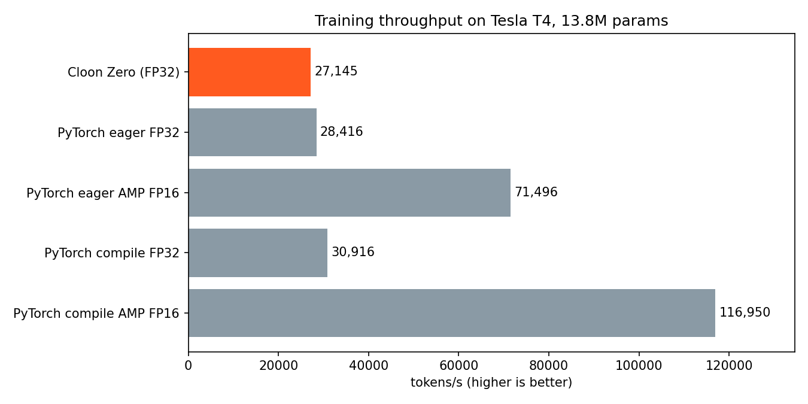
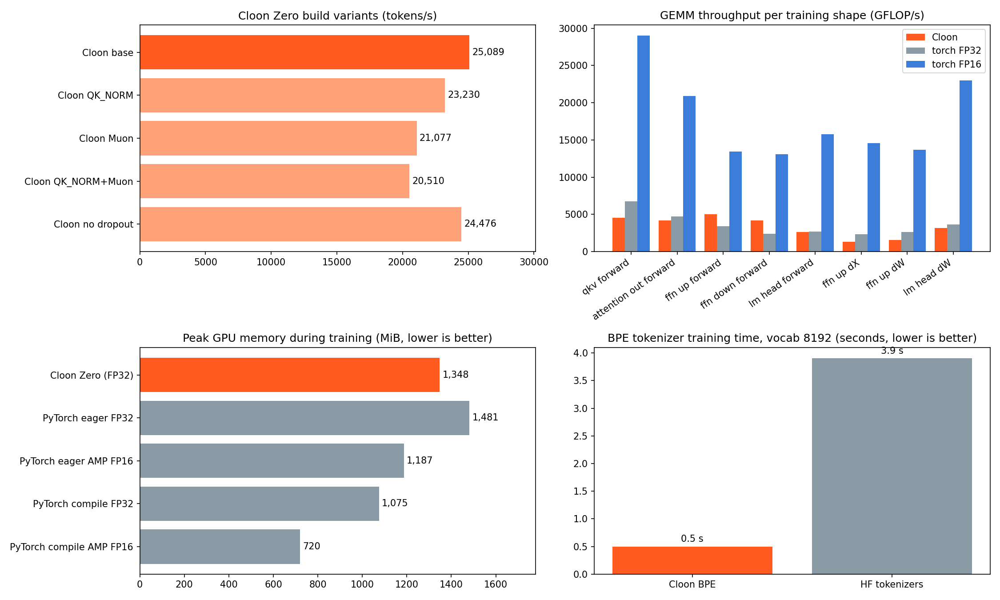
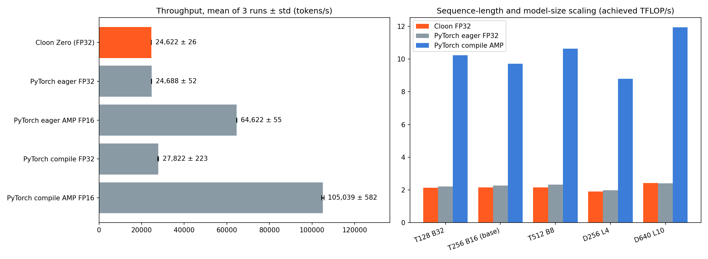

# Cloon Zero: GPT from scratch (C / CUDA, no third-party libraries)

A byte-pair-encoding language model trained from zero. The only dependencies are the C/C++ standard library and the
CUDA runtime: no PyTorch, no tokenizer library, no cuBLAS. Everything, including the matrix multiplication and
attention kernels, is written in this repository.

## Layout

| Path | Purpose |
| --- | --- |
| `src/gpt_cuda.cu` | Model, training loop, checkpoints, generation, CLI, tests and benchmark |
| `src/kernels.cuh` | Device kernels: tiled GEMM, causal softmax, RMSNorm, RoPE, SwiGLU, AdamW, cross-entropy |
| `src/config.h` | Compile-time hyperparameters and shared helpers |
| `src/sampler.h`, `src/rng.h` | Sampling (top-k, min-p, top-p, repetition penalty, n-gram ban) and the RNG |
| `src/bpe.h` | Byte-pair-encoding tokenizer (training, encoding, decoding, serialization) |
| `src/cuda_emu.h` | CPU emulator of the CUDA execution model, used to test the real kernels without a GPU |
| `tools/prep_corpus.c` | Corpus cleaner: line deduplication, junk-line filter, blank-line collapse |
| `scripts/` | Corpus builders (`fetch_dataset.sh` clones documentation folders, `build_corpus.sh` samples local files) |
| `tests/` | Tokenizer round trip, multi-GPU logic and opt-in variant tests |
| `docs/` | Benchmark charts |

## Build and run

```
make gpu                     # nvcc, default ARCH=sm_75 (Tesla T4); override with ARCH=sm_XX
make prep                    # builds the corpus cleaner
make emu                     # CPU emulator build (gpt_emu), no GPU needed
./gpt_cuda check [trials=80] # GEMM unit tests + gradient check on the device
./gpt_cuda selftest          # sampler and anti-loop self-test, no GPU needed
./gpt_cuda bench [vocab=8192]  # GEMM throughput per training shape and one forward+backward microbatch
./gpt_cuda train <corpus.txt> [steps=6000] [model.bin] [vocab=4096] [--gpus auto|N] [--devices a,b] [--seed S] [--patience N]
./gpt_cuda generate <model.bin> [prompt] [tokens=300] [temperature=0.7] [top_k=40] [top_p=0.9] \
                    [repeat_penalty=1.1] [min_p=0.05] [no_repeat_ngram=4]
```

Example: `./gpt_cuda train data/clean.txt 15000 model.bin 8192`. The last 2% of the token stream is held out for validation.

Hyperparameters are compile-time macros, see `src/config.h`. Defaults: `N_EMBD=384`, `N_HEAD=6`, `N_LAYER=6`,
`BLOCK_SIZE=256`, `BATCH=16`, `ACCUM=2`, `DROPOUT=0.1`, `LEARNING_RATE=8e-4`, `WEIGHT_DECAY=0.1`, `GRAD_CLIP=1.0`,
`EMA_DECAY=0.999`. Override at build time, for example `nvcc ... -DN_EMBD=640 -DN_HEAD=10 -DN_LAYER=10 -DACCUM=8`.
Checkpoints record the architecture and refuse to load into a different build.

## Data

```
bash scripts/fetch_dataset.sh all            # clone docs, build dataset/corpus.txt and dataset/MANIFEST.md
./prep_corpus dataset/corpus.txt data/clean.txt [min_dedupe_len=40] [min_alpha_ratio=0.5]
sh scripts/build_corpus.sh corpus.txt 3000000 [dirs...]   # alternative: sample local files
```

`data/MANIFEST.md` lists the sources of the bundled dataset recipe. Licenses differ per source; check each repository
before redistributing a corpus or a model trained on it.

## Features

- RMSNorm, rotary embeddings, SwiGLU, tied embeddings, residual dropout (the mask is a hash of seed and index, nothing stored).
- AdamW with decoupled weight decay on matrices only, global gradient clipping, EMA weights, warmup plus cosine schedule.
- Gradient accumulation and data-parallel training over several GPUs; checkpoints are independent of the GPU count.
- `model.bin` always holds the best `val_ema` weights; `model.bin.ckpt` is the full resume checkpoint.
- Early stop with `--patience N`: training ends when `val_ema` has not improved for N evaluations (default: never).
- Generation with a KV cache and guards: no-repeat n-gram, min-p, top-k, top-p, repetition penalty.

## Opt-in algorithms (off by default)

Both change training dynamics and require a fresh run; checkpoints record them and refuse to load into a build with
different settings.

- `-DQK_NORM=1`: parameter-free RMS normalization of queries and keys before RoPE.
- `-DOPTIMIZER_MUON=1`: Muon for the attention and FFN weight matrices (Nesterov momentum, Newton-Schulz
  orthogonalization, update scaled so AdamW's learning rate and weight decay carry over, following arXiv 2502.16982).
  Embeddings and norm gains stay on AdamW. Tunables: `MUON_MOMENTUM`, `MUON_NS_STEPS`, `MUON_UPDATE_SCALE`.

## Benchmarks

Tesla T4, 13.8M parameters (default architecture, vocab 8192, sequence 256, batch 16). Cloon Zero runs FP32 only.
The charts come from separate runs, so absolute numbers differ slightly between them.



Cloon Zero lands at roughly PyTorch eager FP32 speed (24,622 vs 24,688 tokens/s, mean of 3 runs) and below
`torch.compile` FP32. PyTorch with AMP FP16 is 2.6x to 4.3x faster because it uses tensor cores, which this
project does not. Peak memory is below PyTorch eager FP32 but above the compiled and AMP variants. BPE training is faster than HF tokenizers.



- Build variants: `QK_NORM`, `OPTIMIZER_MUON` and both together cost throughput (23,230, 21,077 and 20,510 vs 25,089 tokens/s for the base build).
- GEMM: the hand-written kernels beat torch FP32 on some forward shapes (`ffn up forward`, `ffn down forward`) and trail it on the backward ones.
- Peak memory: 1,348 MiB vs 1,481 MiB for PyTorch eager FP32, 1,075 MiB for compile FP32 and 720 MiB for compile AMP FP16.
- BPE training at vocab 8192: 0.5 s vs 3.9 s for HF tokenizers.



Throughput varies little between runs (std 26 tokens/s for Cloon Zero). Across sequence length and model size,
Cloon Zero stays near PyTorch eager FP32 in achieved TFLOP/s.

Reproduce the GEMM and microbatch numbers with `./gpt_cuda bench`.

## Testing

```
make test
```

Targets: `test-bpe`, `test-grad`, `test-nodropout`, `test-sampler`, `test-multi`, `test-opt`. They cover the tokenizer, GEMM and
gradient checks, the no-dropout variant, the sampler, multi-GPU logic and the opt-in variants, all on the CPU emulator. It needs `data/id_en_corpus.txt`, which is not included; place your own
corpus there.

The emulator checks correctness only. It cannot measure speed, register use, occupancy or bank conflicts; use
`./gpt_cuda bench` on a real GPU.
