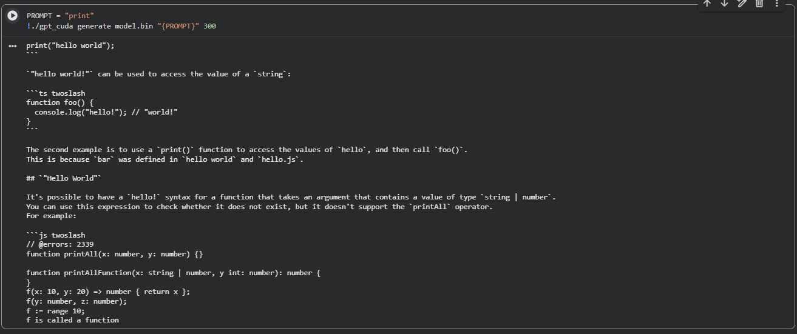

Pre-training:
```
GPU: Tesla T4
BPE: 54682 unique pieces, 97 base symbols
BPE: 500 / 8192 symbols
BPE: 1000 / 8192 symbols
BPE: 1500 / 8192 symbols
BPE: 2000 / 8192 symbols
BPE: 2500 / 8192 symbols
BPE: 3000 / 8192 symbols
BPE: 3500 / 8192 symbols
BPE: 4000 / 8192 symbols
BPE: 4500 / 8192 symbols
BPE: 5000 / 8192 symbols
BPE: 5500 / 8192 symbols
BPE: 6000 / 8192 symbols
BPE: 6500 / 8192 symbols
BPE: 7000 / 8192 symbols
BPE: 7500 / 8192 symbols
BPE: 8000 / 8192 symbols
BPE: 8192 / 8192 symbols
Tokenizer trained in 0.5 s
New model | tokens: 4253693 | bytes/token: 3.01 | vocab: 8192 | parameters: 13767552
block 256 | embd 384 | heads 6 | layers 6 | ffn 1024 | batch 16 x accum 2 | 8192 tokens/step | dropout 0.10
total tokens seen at end: 122.9M (29.5 epochs)

step     50 | train 7.5563 | lr 0.00020 | 258 ms/step | 31755 tok/s
step    100 | train 5.5552 | lr 0.00040 | 264 ms/step | 31047 tok/s
step    150 | train 4.6915 | lr 0.00060 | 270 ms/step | 30301 tok/s
step    200 | train 4.2792 | lr 0.00080 | 278 ms/step | 29488 tok/s
step    250 | train 4.0337 | lr 0.00080 | 284 ms/step | 28845 tok/s | val 3.8906 | val_ema 3.8492 | bpc_ema 1.844 | saved best
step    300 | train 3.8427 | lr 0.00080 | 293 ms/step | 27963 tok/s
step    350 | train 3.6589 | lr 0.00080 | 300 ms/step | 27318 tok/s
step    400 | train 3.5290 | lr 0.00080 | 293 ms/step | 27917 tok/s
step    450 | train 3.4222 | lr 0.00080 | 289 ms/step | 28309 tok/s
step    500 | train 3.3299 | lr 0.00080 | 288 ms/step | 28457 tok/s | val 3.3217 | val_ema 3.2742 | bpc_ema 1.568 | saved best
{...}
step  14550 | train 1.0760 | lr 0.00008 | 291 ms/step | 28134 tok/s
step  14600 | train 1.0810 | lr 0.00008 | 292 ms/step | 28090 tok/s
step  14650 | train 1.0690 | lr 0.00008 | 292 ms/step | 28045 tok/s
step  14700 | train 1.0878 | lr 0.00008 | 293 ms/step | 27986 tok/s
step  14750 | train 1.0567 | lr 0.00008 | 293 ms/step | 27998 tok/s | val 2.7817 | val_ema 2.7290 | bpc_ema 1.307 | no gain 44
step  14800 | train 1.0668 | lr 0.00008 | 293 ms/step | 27998 tok/s
step  14850 | train 1.0600 | lr 0.00008 | 292 ms/step | 28014 tok/s
step  14900 | train 1.0798 | lr 0.00008 | 293 ms/step | 28004 tok/s
step  14950 | train 1.0610 | lr 0.00008 | 292 ms/step | 28040 tok/s
step  15000 | train 1.0609 | lr 0.00008 | 292 ms/step | 28068 tok/s | val 2.7824 | val_ema 2.7364 | bpc_ema 1.311 | no gain 45

Total time: 4573.9 s | model.bin = best EMA weights | model.bin.ckpt = full checkpoint (resume)
Best val_ema: 2.3309 (perplexity 10.3)

--- Sample (from model.bin) ---
    `f32`, `f64`, _f64_, `g32`, and _f32_, are both `f16` and `f128`.

r[asm.register-operands.supported-register-operand]
The register register must be a register which is a register to a register to register operands of the type specified in the assembly code of the register, then a register pointer to an address that is not valid as a register to an `unsafe` block.

r:asm.register.operand-type.supported-operands-in-pointer-type]
* A register that is used with a register can be used as a value to a register.

r---
SPDX-License-Identifier: curl
Long: form-raw
Arg: <string>
Help: Maximum number of bytes
Category: connection timeout
Multi: single
See-also:
  - form
Example:
 -->
-->

This option makes the compiler attempt to specify the specified address, and you can
define it with an error. The compiler may not use a call to a function,
like a function call, or a function call.

## Splitting Headers

The first line of the code in Listing 8-6.0 is the second line
line in which the program starts
```
Model output:
